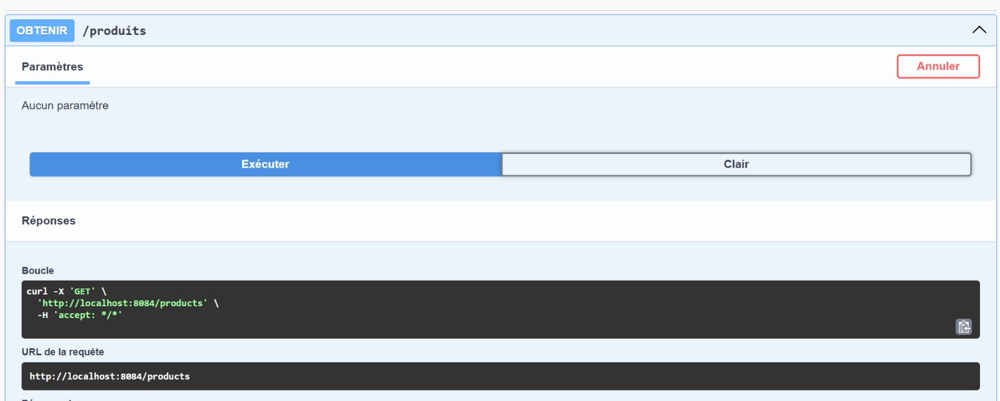
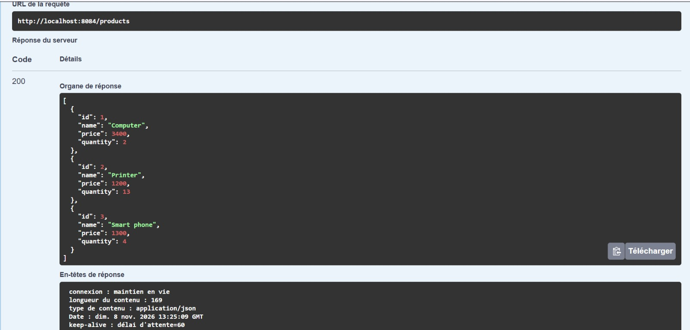
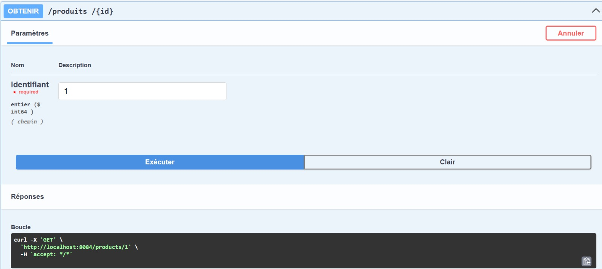
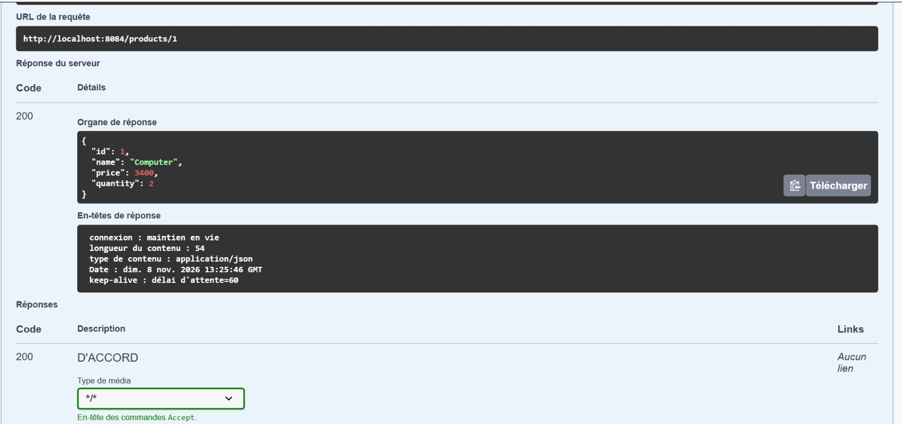
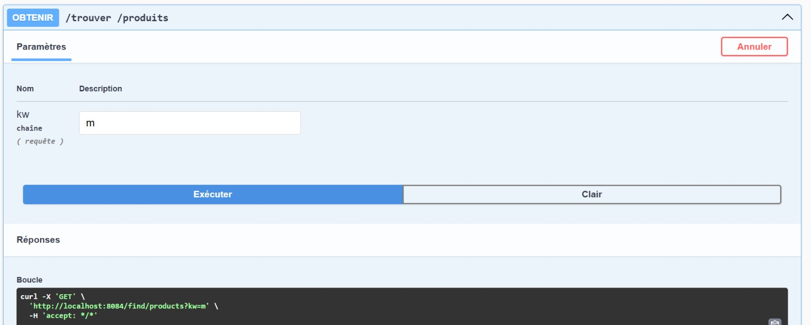
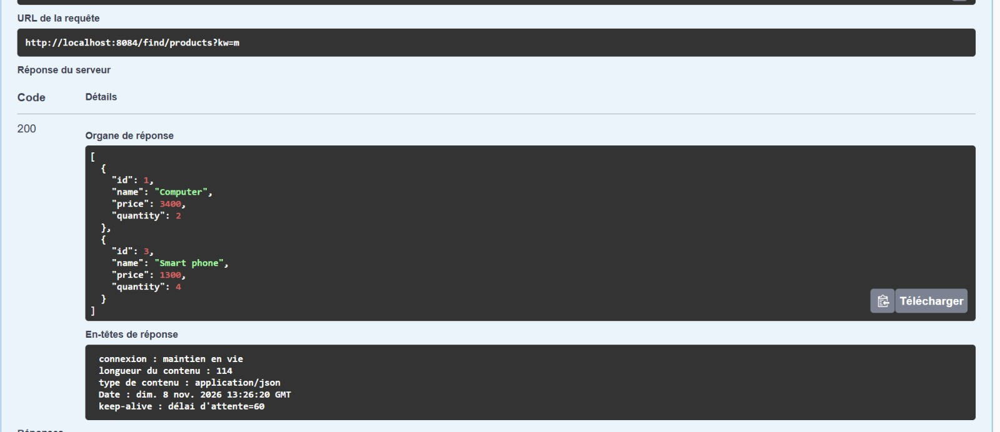
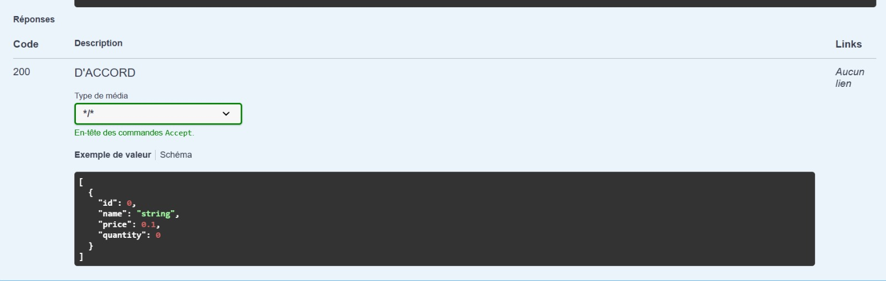
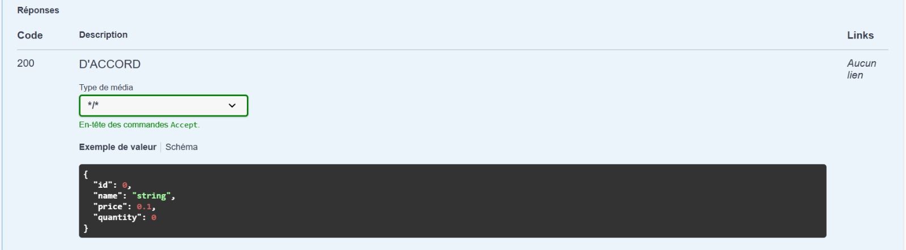
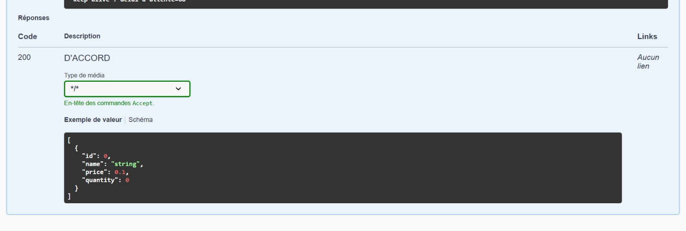
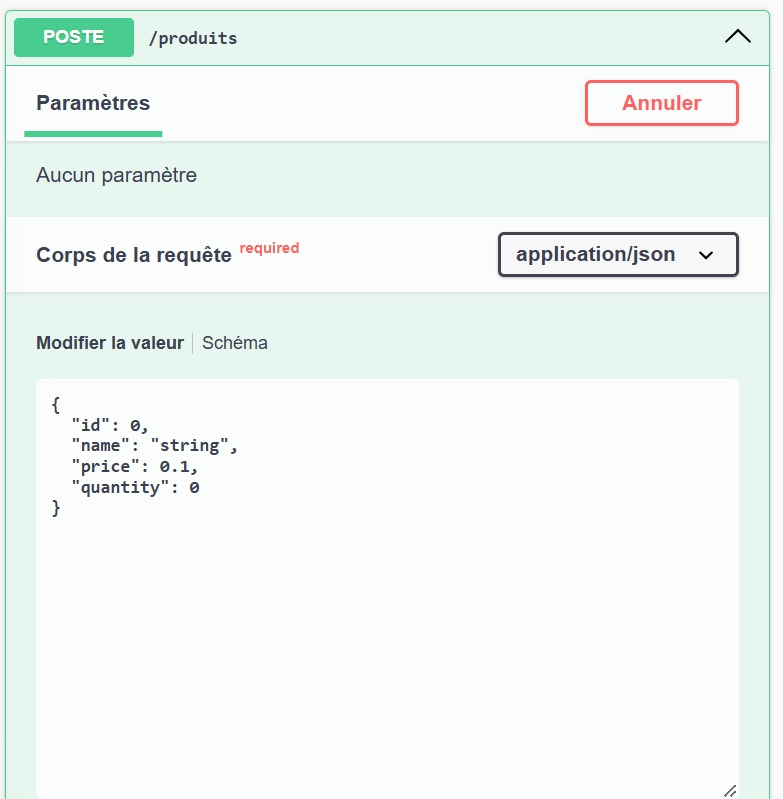

# TP — Gestion des produits avec Spring Boot, Spring Data JPA et H2

> **Compte rendu technique** — Application REST de gestion des produits  
> **Auteur :** Amine Harisse  
> **Projet GitHub :** [`demo-bddc-spring-data`](https://github.com/harisseamine35-lab/demo-bddc-spring-data)

---

## 1. Présentation du TP

Ce TP consiste à développer une application backend avec **Spring Boot** permettant de gérer des produits à travers une API REST. La persistance des données est assurée par **Spring Data JPA**, avec une base de données **H2**.

L'application couvre les opérations CRUD : création, consultation, mise à jour et suppression. Elle propose également une recherche de produits.

## 2. Objectifs pédagogiques

- Créer un projet Spring Boot à l'aide de Spring Initializr.
- Définir une entité persistante avec JPA.
- Utiliser un repository Spring Data JPA.
- Configurer une base de données H2.
- Exposer des opérations de gestion à travers un contrôleur REST.
- Tester les requêtes HTTP et interpréter les réponses JSON avec Swagger UI.

## 3. Environnement et dépendances

| Élément | Utilisation |
|---|---|
| Java | Langage de développement |
| IntelliJ IDEA Ultimate | Environnement de développement (IDE) |
| Spring Boot | Création de l'application backend |
| Spring Web | Création des endpoints REST |
| Spring Data JPA | Accès aux données et opérations de persistance |
| H2 Database | Base de données utilisée pour le TP |
| Lombok | Réduction du code répétitif des classes Java |
| Maven | Gestion des dépendances et construction du projet |
| Swagger UI / OpenAPI | Exploration et test de l'API REST |

## 4. Modèle de données : entité `Product`

L'entité `Product` représente un produit enregistré dans la base de données.

| Attribut | Type Java | Rôle |
|---|---|---|
| `id` | `Long` | Identifiant du produit |
| `name` | `String` | Nom du produit |
| `price` | `double` | Prix du produit |
| `quantity` | `int` | Quantité disponible |

L'identifiant est la clé primaire de l'entité. Les annotations JPA définissent le mapping entre la classe Java et la table relationnelle. Lombok peut être utilisé pour générer automatiquement les accesseurs et autres méthodes répétitives, selon les annotations présentes dans le code.

## 5. Architecture de l'application

L'application suit une séparation simple en couches :

1. **Entité (`Product`)** : décrit la structure des données.
2. **Repository (`ProductRepository`)** : interface d'accès aux données basée sur Spring Data JPA.
3. **Contrôleur REST (`ProductRestController`)** : reçoit les requêtes HTTP, appelle le repository et renvoie les résultats au client.
4. **Configuration (`application.properties`)** : contient les paramètres de connexion et de fonctionnement de H2/JPA.

Cette organisation sépare la représentation des données, leur persistance et l'exposition de l'API.

## 6. Configuration de la persistance

La configuration de la base de données est placée dans `src/main/resources/application.properties`. Le projet utilise H2 pour les essais du TP. Les paramètres exacts à appliquer sont ceux du fichier présent dans le dépôt ; ils peuvent notamment définir l'URL JDBC, le pilote H2, le mode de création du schéma et l'activation de la console H2.

Pour vérifier la configuration, ouvrir le fichier `application.properties` dans IntelliJ et contrôler les propriétés `spring.datasource.*`, `spring.jpa.*` et, si elle est activée, `spring.h2.console.*`.

## 7. API REST — démonstrations

Les captures ci-dessous proviennent des essais Swagger UI fournis avec le projet. Elles montrent la documentation des opérations, la saisie des paramètres et des corps JSON, ainsi que des réponses HTTP. Les réponses `200` visibles indiquent que les requêtes illustrées ont reçu une réponse réussie.

### 7.1 Consulter tous les produits

**Requête observée :** `GET /products`

Cette opération retourne la collection des produits enregistrés. Dans Swagger UI, exécuter l'opération sans paramètre, puis consulter le corps de la réponse JSON.



**Exemple de réponse JSON** (données illustratives) :

```json
[
  { "id": 1, "name": "computer", "price": 5000.0, "quantity": 10 },
  { "id": 2, "name": "printer", "price": 1200.0, "quantity": 5 }
]
```

La réponse réelle dépend des produits présents dans la base H2 au moment du test.



### 7.2 Consulter un produit par son identifiant

**Requête observée :** `GET /products/{id}`

L'identifiant est transmis comme paramètre de chemin. Exemple : `GET /products/1`. L'API renvoie le produit correspondant lorsqu'il existe.





### 7.3 Rechercher des produits

La documentation Swagger fournie présente une opération de recherche avec un paramètre nommé `kw`. Dans la capture, le chemin affiché est `/trouver/produits`.

**Requête observée :** `GET /trouver/produits?kw=m`

Le paramètre `kw` représente le mot-clé utilisé pour filtrer les produits. Remplacer `m` par le mot-clé souhaité pour effectuer une autre recherche.





### 7.4 Schémas de requête affichés par Swagger

Les captures suivantes complètent la documentation interactive de l’API et montrent les schémas de données présentés par Swagger UI.







### 7.5 Ajouter un produit

**Requête observée :** `POST /products`

L'ajout se fait en envoyant un corps JSON contenant les informations du produit. Exemple de corps à adapter aux champs attendus par l'API :

```json
{
  "name": "smartphone",
  "price": 3500.0,
  "quantity": 8
}
```

Dans Swagger UI, choisir `application/json`, saisir le corps de la requête puis cliquer sur **Execute / Exécuter**. Vérifier le code HTTP et le corps de la réponse.



### 7.6 Mettre à jour un produit

La mise à jour fait partie des fonctionnalités demandées dans le TP. Elle est généralement exposée par une requête `PUT` ou `PATCH` ciblant l'identifiant du produit, par exemple `PUT /products/{id}`.

Exemple de corps JSON à adapter à la méthode réellement déclarée dans `ProductRestController` :

```json
{
  "id": 1,
  "name": "computer updated",
  "price": 5200.0,
  "quantity": 12
}
```

Dans Swagger UI, sélectionner l'opération de mise à jour réellement définie dans le contrôleur, renseigner l'identifiant et le corps demandé, exécuter la requête, puis vérifier le résultat avec `GET /products/1`.

> **Capture à compléter :** ajouter ici une capture Swagger montrant la requête de mise à jour et sa réponse.

### 7.7 Supprimer un produit

La suppression est généralement exposée par une requête `DELETE` ciblant l'identifiant, par exemple `DELETE /products/{id}`. Utiliser le chemin exact affiché dans Swagger UI pour le contrôleur de ce projet.

Après l'exécution, vérifier que le produit n'apparaît plus dans `GET /products` ou que sa consultation par identifiant indique qu'il n'existe plus.

> **Capture à compléter :** ajouter ici une capture Swagger montrant la suppression et sa réponse.

## 8. Synthèse des opérations

| Fonctionnalité | Méthode HTTP / chemin illustré ou à vérifier | État des preuves fournies |
|---|---|---|
| Consulter tous les produits | `GET /products` | Capture fournie |
| Consulter un produit | `GET /products/{id}` | Capture fournie |
| Rechercher des produits | `GET /trouver/produits?kw=...` | Capture fournie |
| Ajouter un produit | `POST /products` | Capture fournie |
| Mettre à jour un produit | `PUT` ou `PATCH` — chemin à confirmer dans Swagger | Capture non fournie |
| Supprimer un produit | `DELETE` — chemin à confirmer dans Swagger | Capture non fournie |

## 9. Conclusion

Ce TP a permis de mettre en pratique les bases du développement d'une API REST avec Spring Boot. La création de l'entité `Product`, l'utilisation de Spring Data JPA et la configuration de H2 constituent les éléments essentiels de la persistance. Le contrôleur REST rend les fonctionnalités accessibles par des requêtes HTTP, testées à l'aide de Swagger UI.

Les captures intégrées documentent les démonstrations disponibles. Pour finaliser le rapport, il reste à ajouter les captures des opérations de mise à jour et de suppression après les avoir exécutées dans Swagger UI, et à vérifier leurs chemins exacts dans le contrôleur.

---

## 10. Lien du dépôt

[Consulter le projet sur GitHub](https://github.com/harisseamine35-lab/demo-bddc-spring-data)
